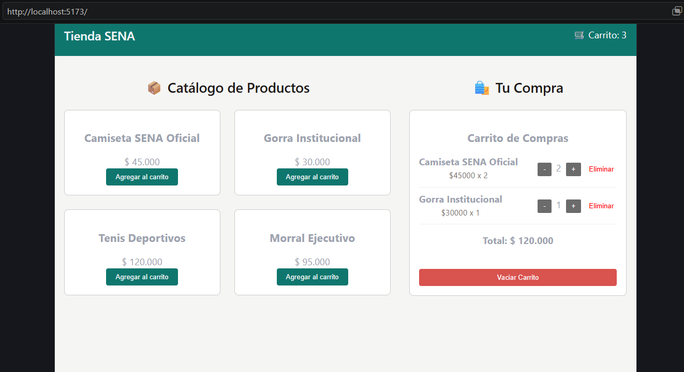

# Tienda SENA - Práctica Zustand
Desarrollado para el programa Análisis y Desarrollo de Software (ADSO) - SENA.

## Manejo de estado
Este proyecto implementa **Zustand** para la gestión del estado global, evitando por completo el *prop drilling* entre componentes que no tienen una relación directa de padre a hijo (como la comunicación independiente entre `Navbar`, `ProductCard` y `CartPanel`).

### Stores implementados:
- **`useCartStore`**: Administra de forma centralizada los elementos del carrito (`items`), las funciones lógicas para agregar (`addItem`), eliminar (`removeItem`), actualizar cantidades (`updateQty`) y vaciar el carrito (`clearCart`). Utiliza el middleware `persist` para almacenar la información de forma automática en el `localStorage` del navegador bajo la clave `tienda-sena-cart`.